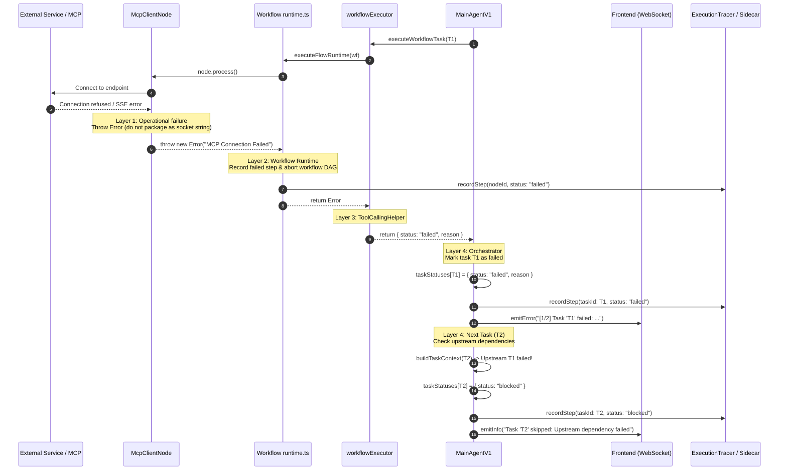

# System Analysis: Error Capture and Status Propagation

## Scope
- **Analyzed functionality**: Error interception, classification, and propagation from individual workflow node processing (`node.process`) through the workflow DAG runtime (`executeFlowRuntime`), execution bridge (`workflowExecutor`), and task-level dependency graph orchestration (`MainAgentV1`).
- **Target state**: Establishing the ideal contract where operational/transport failures (e.g. MCP SSE connectivity loss, HTTP errors, runtime exceptions) are reliably identified as node failures, halt the failing workflow, set the task status to `failed`, and automatically block and skip downstream dependent tasks without spending unnecessary LLM budget.
- **Out of scope**: Visual canvas UI rendering on the frontend client.

---

## Entry Points
- **WebSocket Ingress**: `Websocket/socket.ts` receiving `run_workspace` or `run_workflow` commands.
- **Trigger Execution**: `Execution/Orchestrator.ts` (`runWorkspace` and `runWorkflow`) invoked via HTTP webhooks or scheduled triggers.
- **Subsystem Tests**:
  - `tests/integration/workflows/runtime.test.ts`
  - `tests/unit/agent/MainAgentV1.test.ts`
  - `tests/unit/agent/ToolCallingHelper.test.ts`

---

## Data Flow Trace: Current vs. Desired Ideal Handling

### Current Behavior (Flawed)
1. **Node Level** (`Workflow/Nodes/Mcp/McpClientNode.ts#L533-L541`): When SSE/HTTP connection fails (e.g., `SSE error: Unable to connect`), the `catch` block catches the error and returns `{ [outputSocket]: "Error: ..." }` as a regular string output.
2. **Workflow Output** (`Workflow/Nodes/WorkflowOutputNode.ts#L84-L90`): Consumes the error string on its input socket and returns it as a legitimate workflow output string.
3. **Workflow Runtime** (`Workflow/runtime.ts#L521-L524`): Observes that all nodes completed with outputs and returns `{ layers, results, finalResult: "Error: ..." }` as a resolved object (not an `Error`).
4. **Tool Calling Bridge** (`Agent/Utls/ToolCallingHelper.ts#L43-L60`): Resolves `workflowExecutor` with `{ status: "completed", result: "Error: ..." }`.
5. **Task Orchestrator** (`Agent/Main/Versions/MainAgentV1.ts#L429-L446`): Sees `execution.status === "completed"` and marks `taskStatuses[task.id] = { status: "success" }`, emitting `[SUCCESS]` to the WebSocket client.
6. **Cascading Failure**: Downstream task `T2` sees `T1` marked as `"success"` and proceeds to invoke the Main LLM and Agent LLM (e.g., DeepSeek Reasoner) over the error string, wasting tokens and confusing users.

### Desired Ideal Behavior
1. **Node Level**: Infrastructure, transport, and unrecoverable service errors (e.g. `ECONNREFUSED`, `ETIMEDOUT`, SSE connection drop, invalid configuration) must **throw an exception** rather than masking the error as a valid socket output payload.
2. **Workflow Runtime**: `executeNode` catches the thrown exception, records a failed step in `ExecutionTracer` (`status: "failed"`), terminates further layer processing in that workflow, and returns/throws the `Error`.
3. **Execution Bridge**: `workflowExecutor` traps the error and returns `{ status: "failed", reason: err.message }`.
4. **Task Orchestration**: `executeWorkflowTask` marks `taskStatuses[task.id] = { status: "failed", reason }`, logs the failure in tracer, and emits an `error` message to the WebSocket client (`[1/2] Task 'T1' failed: ...`).
5. **Downstream Dependency Guard**: `MainAgentV1.buildTaskContext` detects `st?.status !== 'success'`, marks dependent tasks as `{ status: "blocked", reason: "Upstream task dependency failed" }`, and `run()` immediately skips them, issuing a `blocked` step in tracer and an `info` skip event.



---

## Components & Responsibilities

| Component | File Path | Current Role | Desired Ideal Responsibility |
|---|---|---|---|
| **McpClientNode** | `Workflow/Nodes/Mcp/McpClientNode.ts` | Catches transport errors and returns them as socket string `{ [sock]: "Error: ..." }` | Must clean up connection handles and re-throw transport/runtime errors so node fails. |
| **Tool / Utility Nodes** | `Workflow/Nodes/*` | Varies (some return error strings, some throw) | Pure data processing errors may route to specific `Error` sockets if defined; unhandled operational errors must throw. |
| **Workflow Runtime** | `Workflow/runtime.ts` | Executes nodes layer by layer; catches errors in `try/catch` | Captures thrown node errors, records `workflow_node` step with `status: "failed"`, halts execution of subsequent workflow nodes, and propagates error to caller. |
| **ToolCallingHelper** | `Agent/Utls/ToolCallingHelper.ts` | Bridges `MainAgentV1` to workflow execution | Ensures any `Error` returned from runtime translates to `{ status: "failed", reason: Error.message }` without masking. |
| **MainAgentV1** | `Agent/Main/Versions/MainAgentV1.ts` | Coordinates task graph and agent loops | Evaluates `execution.status`; records `task: failed` when workflow fails; cascades failure to mark dependent tasks `blocked`; skips blocked tasks without LLM cost. |
| **ExecutionTracer** | `Execution/ExecutionTracer.ts` | Records execution steps and generates `.json` sidecar | Truthfully records `failed` and `blocked` statuses across node and task lifecycle steps. |

---

## Interfaces & Contracts

### 1. Node Execution Contract (`Workflow/types/types.ts`)
```typescript
interface BaseNode {
  process: (context: NodeExecutionContext) => Promise<NodeValue | undefined>;
}
```
* **Preconditions**: Inputs resolved from upstream connections.
* **Postconditions on Success**: Returns a record of socket values (`{ [socketId]: value }`) or node value.
* **Contract on Failure**: If the node cannot perform its operation due to external transport, authentication, or unrecoverable processing error, it MUST throw an `Error`. It MUST NOT return an error string as a substitute for valid socket data unless an explicit error socket exists.

### 2. Workflow Runtime Contract (`Workflow/runtime.ts`)
```typescript
export const executeFlowRuntime: (
  workflow: Workflow,
  ctx: ExecutionContext,
  context?: string,
  triggerData?: unknown,
  broadcast?: (data: unknown) => void,
  tracer?: ExecutionTracer
) => Promise<{ layers: number[][]; results: Record<string, unknown>; finalResult: unknown } | Error>;
```
* **Success**: Returns `{ layers, results, finalResult }`.
* **Failure**: When any node throws an unhandled error:
  - Records step in tracer: `{ type: "workflow_node", status: "failed", details: err.message }`.
  - Halts further node execution in that workflow.
  - Returns `Error` (or `FatalMainLLMError`).

### 3. Workflow Executor Contract (`Agent/Utls/ToolCallingHelper.ts`)
```typescript
export async function workflowExecutor(
  ctx: ExecutionContext,
  workflowId: string,
  input?: string,
  triggerData?: unknown,
  broadcast?: (data: unknown) => void,
  tracer?: ExecutionTracer,
): Promise<{ status: "completed" | "failed"; reason?: string; result?: unknown }>;
```
* **Success**: Returns `{ status: "completed", result }`.
* **Ordinary Failure**: Returns `{ status: "failed", reason: err.message }`.
* **Fatal Main LLM Failure**: Re-throws `FatalMainLLMError` to initiate workspace-wide abort.

### 4. Task Status & Dependency Contract (`Agent/Main/Versions/MainAgentV1.ts`)
```typescript
type TaskStatusRecord = Record<string, { status: "success" | "failed" | "blocked"; reason?: string }>;
```
* **Upstream Check (`buildTaskContext`)**:
  ```typescript
  for (const dep of layer.context) {
    const st = statuses[dep];
    if (st?.status !== "success") {
      statuses[layer.taskId] = {
        status: "blocked",
        reason: `Upstream task dependency '${dep}' not completed successfully`,
      };
      return "";
    }
  }
  ```
* **Execution Guard in `run()`**:
  ```typescript
  if (taskStatuses[task.id]?.status === "blocked") {
    this.tracer.recordStep({
      type: "task",
      name: task.title,
      status: "blocked",
      taskId: task.id,
      details: taskStatuses[task.id]?.reason,
    });
    this.emitInfo(`Task '${task.title}' skipped: ${taskStatuses[task.id]?.reason}`);
    step++;
    continue;
  }
  ```

### 5. Workspace Completion & Terminal Reporting Contract (`MainAgentV1.ts`)
```typescript
type WorkspaceExecutionStatus = "completed" | "failed" | "partial_success" | "aborted";

interface WorkspaceSummaryMetrics {
  totalTasks: number;
  succeededTasks: number;
  failedTasks: number;
  blockedTasks: number;
}
```
* **Terminal Status Calculation (`finalize`)**:
  ```typescript
  const total = layers.length;
  const succeeded = layers.filter(l => taskStatuses[l.taskId]?.status === "success").length;
  const failed = layers.filter(l => taskStatuses[l.taskId]?.status === "failed").length;
  const blocked = layers.filter(l => taskStatuses[l.taskId]?.status === "blocked").length;

  let status: WorkspaceExecutionStatus = "completed";
  let statusReason = "Workspace completed successfully.";

  if (this.aborted) {
    status = "aborted";
    statusReason = "Workspace execution was aborted.";
  } else if (failed > 0 && succeeded === 0) {
    status = "failed";
    statusReason = `Workspace execution failed: ${failed} task${failed > 1 ? "s" : ""} failed, ${blocked} blocked.`;
  } else if (failed > 0 || blocked > 0) {
    status = "partial_success";
    statusReason = `Workspace execution finished with partial failures: ${succeeded} succeeded, ${failed} failed, ${blocked} blocked.`;
  }
  ```
* **Truthful Terminal Logging & WebSocket Events**:
  - `status === "completed"`: Emits `level: "success"`, message `"Workspace completed successfully."`, and prints `✅ Workspace '<name>' completed successfully.`
  - `status === "failed"`: Emits `level: "error"`, message `statusReason`, sends WebSocket `type: "error"`, `code: "WORKSPACE_FAILED"`, and prints `❌ Workspace '<name>' execution failed: ${statusReason}`.
  - `status === "partial_success"`: Emits `level: "warn"`, message `statusReason`, sends WebSocket warning, and prints `⚠️ Workspace '<name>' completed with partial failures: ${statusReason}`.
* **Structured Sidecar Schema (`.json`) for Autonomous Optimization Agents**:
  Designed specifically so that autonomous evaluator and optimizer agents can detect problems, critique prompts, and suggest workspace enhancements:
  - Root `status`: `WorkspaceExecutionStatus` (`"completed" | "failed" | "partial_success" | "aborted"`)
  - Root `statusReason`: Human-readable summary sentence
  - Root `summary`: `WorkspaceSummaryMetrics` (`totalTasks`, `succeededTasks`, `failedTasks`, `blockedTasks`)
  - Root `taskConnections`: Array of `{ fromTask, toTask }` preserving the declarative task dependency DAG
  - In `tasks[]`: Full task blueprint (`taskId`, `title`, `type`, `role`, `description`, `systemPrompt`, `expectedOutput`, `executorId`) alongside runtime outcome (`status`, `reason: string | null`, `durationMs`, `result: unknown | null`).
  - In `agents[]`: Full agent blueprint (`id`, `name`, `role`, `background`, `systemPrompt`, `provider`, `model`, `modelId`, `tools`).
  - In `workflows[]`: Clean executable workflow graph (`id`, `name`, `nodes` with parameters and sockets, `connections`).
  - Root `diagnostics`: First-class root-cause attribution:
    - `hasFailures`: boolean
    - `rootCauses`: array of `{ source, taskId, workflowId, nodeId, nodeType, nodeTitle, errorCategory, message, failedInput, suggestedRemediation }`
    - `impactedTasks`: array of `{ taskId, title, impact: "BLOCKED", reason }`
  - In `finalResult`: `status === "completed" ? results["__final__"] : null` (never stringified `"{}"` on failure).
  - In `exitStatus`: Runner exit categorization enum: `"success"` | `"aborted"` | `"blocked"` | `"validation_error"` (repurposing the legacy `aborted: boolean` flag).
* **Text Output Formatting (`.txt`)**:
  - For non-successful tasks, replaces `undefined` with `[FAILED] ${reason}` or `[BLOCKED] ${reason}`.

---

## Dependencies
| Dependency | Usage | Location |
|---|---|---|
| `ExecutionTracer` | Records granular step outcomes (`workflow_node`, `task`, `agent_iteration`) with `status: "failed"` and `"blocked"` | `Execution/ExecutionTracer.ts` |
| `ToolCallingHelper` | Standardized wrapper returning `{ status: "completed" \| "failed" }` | `Agent/Utls/ToolCallingHelper.ts` |
| `WorkspaceValidator` | Pre-execution schema validation preventing invalid graphs | `Agent/Validation/WorkspaceValidator.ts` |

---

## Tests & Verification

| Test File | Type | What It Verifies |
|---|---|---|
| `tests/unit/agent/MainAgentV1.test.ts` | Unit | Verifies that when a workflow task fails, a dependent agent task is marked `blocked` and skipped without executing `assignBestFit` or running the agent. |
| `tests/unit/agent/ToolCallingHelper.test.ts` | Unit | Verifies that runtime errors return `{ status: "failed", reason }` and `FatalMainLLMError` is rethrown. |
| `tests/integration/workflows/runtime.test.ts` | Integration | Verifies that when `node.process()` throws, a failed step is recorded in `ExecutionTracer` with node ID, inputs, and error details. |

---

## Demonstration

### Concrete Scenario: MCP Server Unreachable
When workspace `AAA` runs with Task 1 (`T1 ` -> MCP Client calling `read_email` on `http://localhost:3003`) and Task 2 (`T2` -> Judge agent produce final verdict):

1. **At `McpClientNode`**:
   - Call to `http://localhost:3003` throws `SSE error: Unable to connect`.
   - Node cleans up client handle and throws `Error("MCP Client failed: SSE error: Unable to connect")`.
2. **At `Workflow/runtime.ts`**:
   - `executeNode` records tracer step:
     ```json
     {
       "type": "workflow_node",
       "name": "MCP Client",
       "status": "failed",
       "nodeId": 3,
       "details": "MCP Client failed: SSE error: Unable to connect"
     }
     ```
   - Workflow DAG execution stops immediately; `WorkflowOutputNode` never runs.
   - `executeFlowRuntime` returns `Error("MCP Client failed: SSE error: Unable to connect")`.
3. **At `MainAgentV1.executeWorkflowTask`**:
   - `workflowExecutor` returns `{ status: "failed", reason: "MCP Client failed: SSE error: Unable to connect" }`.
   - Sets `taskStatuses["T1"] = { status: "failed", reason: "MCP Client failed..." }`.
   - Emits WebSocket message:
     ```json
     {
       "type": "error",
       "code": "EXECUTION_ERROR",
       "message": "[1/2] Task 'T1 ' failed: MCP Client failed: SSE error: Unable to connect"
     }
     ```
4. **At `MainAgentV1.run()` for Task 2**:
   - `buildTaskContext(T2)` detects `taskStatuses["T1"].status === "failed"`.
   - Marks `taskStatuses["T2"] = { status: "blocked", reason: "Upstream task dependency 'T1 ' not completed successfully" }`.
   - `run()` records tracer step:
     ```json
     {
       "type": "task",
       "name": "T2",
       "status": "blocked",
       "taskId": "tk-6768160ox",
       "details": "Upstream task dependency 'T1 ' not completed successfully"
     }
     ```
   - Emits WebSocket message:
     ```json
     {
       "type": "message",
       "data": { "type": "info", "message": "Task 'T2' skipped: Upstream task dependency 'T1 ' not completed successfully" }
     }
     ```
   - Execution finishes with zero LLM API calls spent on `T2`.
5. **At `MainAgentV1.finalize()`**:
   - Computes: `total = 2, succeeded = 0, failed = 1, blocked = 1`.
   - Derives `status = "failed"`, `statusReason = "Workspace execution failed: 1 task failed, 1 blocked."`.
   - Emits terminal WebSocket event:
     ```json
     {
       "type": "error",
       "commandType": "run_workspace",
       "code": "WORKSPACE_FAILED",
       "message": "Workspace execution failed: 1 task failed, 1 blocked."
     }
     ```
   - Terminal log in `logs[]`:
     ```json
     {
       "timestamp": "2026-10-29T17:47:15.362Z",
       "level": "error",
       "message": "Workspace execution failed: 1 task failed, 1 blocked.",
       "details": null
     }
     ```
   - Generated `.json` sidecar root:
     ```json
     {
       "workspace": "AAA",
       "status": "failed",
       "statusReason": "Workspace execution failed: 1 task failed, 1 blocked.",
       "summary": {
         "totalTasks": 2,
         "succeededTasks": 0,
         "failedTasks": 1,
         "blockedTasks": 1
       },
       "taskConnections": [
         {
           "fromTask": "tk-601794axs",
           "toTask": "tk-6768160ox"
         }
       ],
       "tasks": [
         {
           "taskId": "tk-601794axs",
           "title": "T1 ",
           "type": "workflow",
           "executorId": "wf-0886992fo",
           "role": "Email Collector",
           "description": "Fetch unread emails via MCP tool",
           "systemPrompt": "",
           "expectedOutput": "JSON array of email records",
           "status": "failed",
           "reason": "SSE error: Unable to connect. Is the computer able to access the url?",
           "durationMs": 18,
           "result": null
         },
         {
           "taskId": "tk-6768160ox",
           "title": "T2",
           "type": "agentic",
           "executorId": "ag-658152nen",
           "role": "Judge",
           "description": "Evaluate incoming email contents and produce verdict",
           "systemPrompt": "Analyze the emails and determine priority",
           "expectedOutput": "Summary verdict report",
           "status": "blocked",
           "reason": "Upstream task dependency 'tk-601794axs' not completed successfully",
           "durationMs": 0,
           "result": null
         }
       ],
       "diagnostics": {
         "hasFailures": true,
         "rootCauses": [
           {
             "source": "workflow_node",
             "taskId": "tk-601794axs",
             "workflowId": "wf-0886992fo",
             "nodeId": 3,
             "nodeType": "McpClient",
             "nodeTitle": "MCP Client",
             "errorCategory": "TRANSPORT_ERROR",
             "message": "SSE error: Unable to connect. Is the computer able to access the url?",
             "failedInput": {},
             "suggestedRemediation": "Verify connectivity to the MCP Server URL 'http://localhost:3003' or ensure the target server is listening."
           }
         ],
         "impactedTasks": [
           {
             "taskId": "tk-6768160ox",
             "title": "T2",
             "impact": "BLOCKED",
             "reason": "Upstream task dependency 'tk-601794axs' not completed successfully"
           }
         ]
       },
       "finalResult": null,
       "exitStatus": "blocked"
     }
     ```
   - Generated `.txt` output:
     ```text
     AAA Workspace Execution Results
     ...
     tk-601794axs
     [FAILED] SSE error: Unable to connect. Is the computer able to access the url?

     tk-6768160ox
     [BLOCKED] Upstream task dependency 'tk-601794axs' not completed successfully
     ```
